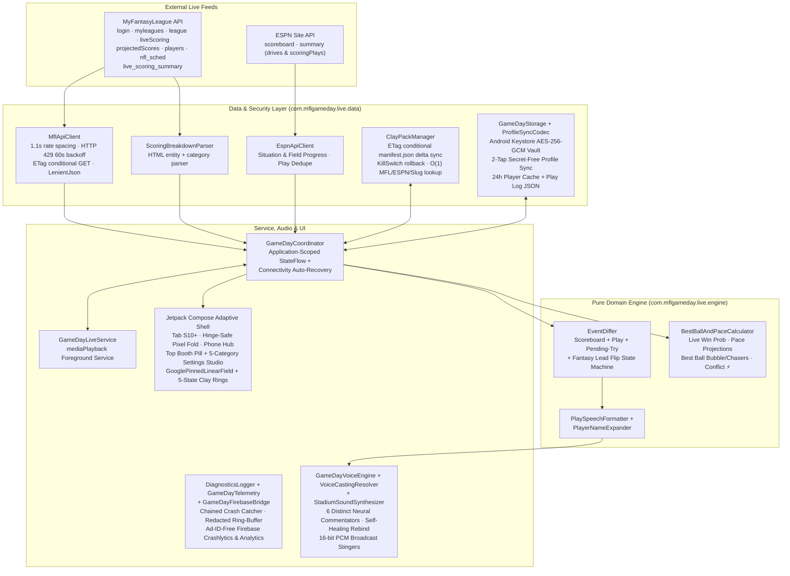

# Architecture Map — MFL GameDay Live (Android)

## Overview

MFL GameDay Live is a native Kotlin + Jetpack Compose Android application (`minSdk = 31`, `targetSdk = 36`, `compileSdk = 36`) that ports and extends MyFantasyLeague's classic Windows `Gameday.exe` desktop client and `darcuri/gameannouncer` into a multi-league, multi-form-factor mobile, foldable, tablet, and desktop broadcast client.

## Runtime Entrypoints

1. **`MflGameDayApp` (`Application`)**: Initializes the singleton `GameDayCoordinator` and configures `Coil` with `ImageDecoderDecoder` for native animated GIF rendering (supporting MFL commissioner/franchise helmet GIFs).
2. **`MainActivity` (`ComponentActivity`)**: Edge-to-edge Compose host observing `GameDayCoordinator.uiState`, managing `WindowManager.LayoutParams.FLAG_KEEP_SCREEN_ON` for uninterrupted tablet/couch viewing, and requesting `POST_NOTIFICATIONS` on Android 13+.
3. **`GameDayLiveService` (`LifecycleService`, `foregroundServiceType="mediaPlayback"`) + `MediaSession` + `NotificationDismissReceiver` + `PregameWakeReceiver` + `ServiceLifecyclePolicy`**: Android 14–17 compliant Foreground Service with native `MediaSession` (`Notification.MediaStyle` Quick Settings media player + Bluetooth/lock-screen metadata), `PARTIAL_WAKE_LOCK`, and `WIFI_MODE_FULL_LOW_LATENCY` `WifiLock`. Strictly gated to **active NFL game windows** (`LIVE`, `HALFTIME`, or `SCHEDULED` within 90 minutes of kickoff, plus Demo Simulator) with a local `$0` `AlarmManager.setWindow` wakeup (`PregameWakeReceiver`) when Sunday morning standby starts `>90m` before kickoff. Clearing notifications in the Android 14–16 shade (`ACTION_NOTIFICATION_DISMISSED`) keeps the live audio broadcast uninterrupted; speech & polling stop cleanly on explicit `Stop`, Recent Apps swipe-close (`onTaskRemoved`), or games finishing (`FINAL`), and auto-resume on next launch or window focus (`MainActivity.onStart` / `onWindowFocusChanged`).

## Component & Data Flow

## Key Technical Decisions

- **`mediaPlayback` Foreground Service + Transient Audio Ducking**: Android 15–17 background audio hardening suppresses background audio unless backed by a While-In-Use `mediaPlayback` foreground service. `GameDayVoiceEngine` requests `AUDIOFOCUS_GAIN_TRANSIENT_MAY_DUCK` only while speaking an utterance so background music/podcasts duck cleanly and resume immediately.
- **Manifest `<queries>` for `TTS_SERVICE`**: Required on Android 11+ package visibility rules so `TextToSpeech` binds to Google Speech Services and Samsung TTS engines reliably.
- **Best Ball (`bestLineup = Yes`) & Multi-League Conflict Intelligence**: Automatically detects Best Ball leagues from MFL `league` metadata, tracks optimal bubble starters vs live bench chasers, respects per-league decimal `precision`, pins the user's franchise (`YOU`) consistently across single and doubleheader matchups, restricts bench outscore alerts to 4Q/Final starters (`gameSecondsRemaining <= 900`), and flags players started on your team in League A while facing you in League B (`CONFLICT ⚡`).
- **Bandwidth-Respectful Polling, Immediate ESPN Voice Dispatch & Automatic Week Rollover (`GameDayCoordinator` + `MflApiClient` + `ServiceLifecyclePolicy`)**: Enforces 1.1s minimum request spacing, OkHttp 25s HTTP/2 ping keep-alives, `ETag`/`If-None-Match` conditional GETs, fail-fast HTTP 429 60s cooldowns (never stalling ESPN polls), immediate `~300ms` voice dispatch for ESPN NFL plays ahead of sequential MFL league HTML scraping, score-delta gating on `live_scoring_summary` HTML breakdowns (~80% fewer MFL HTML fetches), and automatic lockstep week rollover (`MflStatusInfo.effectiveActiveWeek`).
- **Post-Score `PAT_PENDING` / `KICKOFF_PENDING` Field State & Opt-In Tabular Box-Score Ledger (`LiveFieldSituationResolver` + `GooglePinnedLinearField` + `ScoringBreakdownFormatter`)**: Resolves post-TD tries and commercial-break `"Official Timeout"` intervals so games transition out of false Red Zone states onto a 35-yard Kickoff Tee + parabolic flight arc until the kickoff/touchback or next `1st & 10`. On `FantasyMatchupsScreen`, preserves `Lineup Cards` as the default while offering a 1-tap `Scoring Details` tabular box-score ledger (catches, yards, rushes, 2-pt conversions, TDs, fumbles, kicking, IDP/Defense rollups, and raw-to-rounded league score audits).
- **Decoupled 3D Claymation Visual System, 5-State Rings & Edge-to-Edge Linear Stadium Field (`ClayPackManager` + `ClayMascotResources` + `BroadcastComponents`)**: Bundles all 32 original 3D polymer-clay team mascots (`~245 KB`) and 6 sculpted 3D clay base/fallback layers (`~42 KB`: `BlendMode.Modulate` team-tinted `#Number` jersey torso, Dark-Visor Skill Helmet, 6-Bar Bull-Cage IDP Helmet, Armored Fortress Defense Shield, Coach Hoodie/Headset, and Gold Trophy Crest) inside the APK for `0ms` offline rendering across all 25 MFL position codes, while lazily fetching and caching `~5.7 KB` neck-up clay busts via an `ETag`-gated delta manifest (`https://www.motisko.com/assets/gameday/clay/manifest.json`) so mid-season NFL trades recolor jerseys automatically with zero asset updates. `PlayerAvatarRingPolicy` renders unambiguous 5+1 player states (`FINAL_DONE` `0.dp` settled, `SCHEDULED_UPCOMING` `1.0.dp` muted, `GAME_LIVE` `1.9.dp` team primary avoiding 8-team yellow accent collisions, `HAS_POSSESSION` `2.6.dp` Championship Gold + halo, `IN_RED_ZONE` pulsing Crimson Red, and `DEFENDING_RED_ZONE`), paired with edge-to-edge `GooglePinnedLinearField` (`40.dp`/`54.dp` on NFL cards & Game Center) and conditional `PlayerMicroDriveStrip` (`14.dp`) on active ball-carriers.
- **Deterministic 6-Commentator Neural Voice Casting & Adaptive Multi-Device Settings Hub (`VoiceCastingResolver` + `SettingsAndVoicesScreen`)**: Maps 6 named commentators (*David*, *Red Zone Rex*, *Callie*, *Nigel 🇬🇧*, *Macca 🇦🇺*, *Coach Vance*) across distinct installed Android neural `Voice` instances (`US`/`GB`/`AU`, network quality, and gender heuristics) and resets `defaultEngineVoice` when switching personas so Samsung/Google TTS never sticks on a previous voice. Settings adapts across `<520.dp` Phone Hub + Drill-In (`BackHandler`), `520..819.dp` hinge-safe `280.dp` Foldable Split, and `>=820.dp` `310.dp` Tablet Split, complemented by a 1-tap Top Header Booth Pill (`QuickBoothBottomSheet`).
- **Dual Distribution Flavors (`direct` vs `playStore`), Flavor-Isolated In-App Updates & Zero-Browser Play API Pipeline (`InAppUpdatePolicy` + `scripts/play-publish.mjs`)**: `direct` (`com.mflgameday.live`) builds the GitHub Release APK with a 24h non-blocking release notifier (`src/direct` only, compiled out of Play builds); `playStore` (`com.motiskoventures.gameday`) produces the Google Play `.aab` bundle with `com.google.android.play:app-update-ktx` (`playStoreImplementation` only: Flexible non-blocking background updates with 7-day snooze & live-speech deferral on `inAppUpdatePriority 0..3`, plus Immediate full-screen updates on `inAppUpdatePriority 4..5`), HTTPS-only `network_security_config.xml`, `AD_ID` & `REQUEST_IGNORE_BATTERY_OPTIMIZATIONS` manifest stripping, and `allowBackup="false"` + `data_extraction_rules.xml` vault isolation. Post-launch `.aab` uploads (`--update-priority=0..5`), staged rollouts, emergency halts, store-listing updates, and Android Vitals queries run via `scripts/play-publish.mjs` using built-in Node `node:crypto` RS256 JWTs and an isolated, read-only 1Password `GameDay` vault (`keystore/gameday-op-sa.dpapi` Windows DPAPI token, zero secrets on disk).
