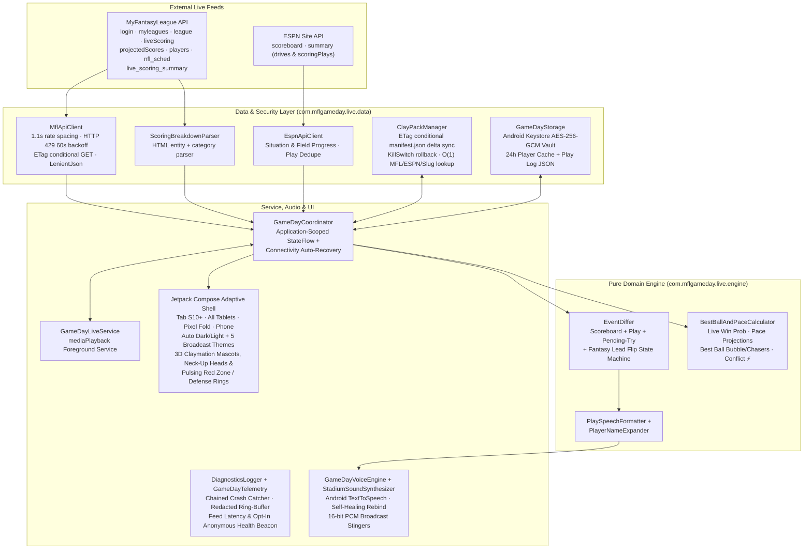

# Architecture Map — MFL GameDay Live (Android)

## Overview

MFL GameDay Live is a native Kotlin + Jetpack Compose Android application (`minSdk = 31`, `targetSdk = 36`, `compileSdk = 36`) that ports and extends MyFantasyLeague's classic Windows `Gameday.exe` desktop client and `darcuri/gameannouncer` into a multi-league, multi-form-factor mobile, foldable, tablet, and desktop broadcast client.

## Runtime Entrypoints

1. **`MflGameDayApp` (`Application`)**: Initializes the singleton `GameDayCoordinator` and configures `Coil` with `ImageDecoderDecoder` for native animated GIF rendering (supporting MFL commissioner/franchise helmet GIFs).
2. **`MainActivity` (`ComponentActivity`)**: Edge-to-edge Compose host observing `GameDayCoordinator.uiState`, managing `WindowManager.LayoutParams.FLAG_KEEP_SCREEN_ON` for uninterrupted tablet/couch viewing, and requesting `POST_NOTIFICATIONS` on Android 13+.
3. **`GameDayLiveService` (`LifecycleService`, `foregroundServiceType="mediaPlayback"`) + `NotificationDismissReceiver` + `ServiceLifecyclePolicy`**: Android 14–17 compliant Foreground Service with `PARTIAL_WAKE_LOCK` and deduplicated notification controls (`Mute/Unmute`, `Refresh`, `Stop`, plus `setDeleteIntent` swipe-dismiss shutdown). Strictly gated to **active NFL game windows** (`LIVE`, `HALFTIME`, or `SCHEDULED` within 90 minutes of kickoff, plus Demo Simulator) so zero background polling, WakeLocks, or shade notifications run mid-week, overnight, or after Monday/Sunday/Thursday Night Football concludes. Cleanly stops speech & polling when the user swipes the app closed from Recent Apps (`onTaskRemoved`) or dismisses the notification, and automatically resumes on next launch (`MainActivity.onStart`).

## Component & Data Flow

## Key Technical Decisions

- **`mediaPlayback` Foreground Service + Transient Audio Ducking**: Android 15–17 background audio hardening suppresses background audio unless backed by a While-In-Use `mediaPlayback` foreground service. `GameDayVoiceEngine` requests `AUDIOFOCUS_GAIN_TRANSIENT_MAY_DUCK` only while speaking an utterance so background music/podcasts duck cleanly and resume immediately.
- **Manifest `<queries>` for `TTS_SERVICE`**: Required on Android 11+ package visibility rules so `TextToSpeech` binds to Google Speech Services and Samsung TTS engines reliably.
- **Best Ball (`bestLineup = Yes`) & Multi-League Conflict Intelligence**: Automatically detects Best Ball leagues from MFL `league` metadata, tracks optimal bubble starters vs live bench chasers, respects per-league decimal `precision`, pins the user's franchise (`YOU`) consistently across single and doubleheader matchups, restricts bench outscore alerts to 4Q/Final starters (`gameSecondsRemaining <= 900`), and flags players started on your team in League A while facing you in League B (`CONFLICT ⚡`).
- **Bandwidth-Respectful Polling & Automatic Week Rollover (`GameDayCoordinator` + `MflApiClient` + `ServiceLifecyclePolicy`)**: Enforces 1.1s minimum request spacing, `ETag`/`If-None-Match` conditional GETs, HTTP 429 60s backoff, score-delta gating on `live_scoring_summary` HTML breakdowns (~80% fewer MFL HTML fetches), and automatic lockstep week rollover (`MflStatusInfo.effectiveActiveWeek` advancing as soon as `CompletedWeek >= LiveScoringWeek` or when all prior-week games are `FINAL` and ESPN's scoreboard rolls forward, plus immediate `0ms` wake & status check in `onAppForegrounded()` and `refreshNow()`).
- **Decoupled 3D Claymation Visual System & Over-the-Air Delta Pack (`ClayPackManager` + `ClayMascotResources` + `BroadcastComponents`)**: Bundles all 32 original 3D polymer-clay team mascots (`~245 KB`) and 6 sculpted 3D clay base/fallback layers (`~42 KB`: `BlendMode.Modulate` team-tinted `#Number` jersey torso, Dark-Visor Skill Helmet, 6-Bar Bull-Cage IDP Helmet, Armored Fortress Defense Shield, Coach Hoodie/Headset, and Gold Trophy Crest) inside the APK for `0ms` offline rendering across all 25 MFL position codes, while lazily fetching and caching `~5.7 KB` neck-up clay busts via an `ETag`-gated delta manifest (`https://www.motisko.com/assets/gameday/clay/manifest.json`) so mid-season NFL trades recolor jerseys automatically with zero asset updates. Includes pulsing Crimson Red Zone rings for offensive starters driving inside the 20 and Goal-Line Stand defense rings when opposing offenses are on the field.
- **Dual Distribution Flavors (`direct` vs `playStore`) & Zero-Browser Play API Pipeline (`scripts/play-publish.mjs`)**: `direct` (`com.mflgameday.live`) builds the GitHub Release APK; `playStore` (`com.motiskoventures.gameday`) produces the Google Play `.aab` bundle with HTTPS-only `network_security_config.xml`, `AD_ID` & `REQUEST_IGNORE_BATTERY_OPTIMIZATIONS` manifest stripping, and `allowBackup="false"` + `data_extraction_rules.xml` vault isolation. Post-launch `.aab` uploads, staged rollouts, emergency halts, store-listing updates, and Android Vitals queries run via `scripts/play-publish.mjs` using built-in Node `node:crypto` RS256 JWTs and an isolated, read-only 1Password `GameDay` vault (`keystore/gameday-op-sa.dpapi` Windows DPAPI token, zero secrets on disk).
