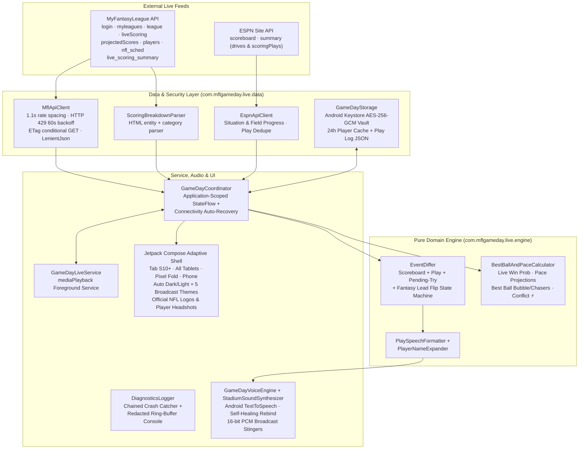

# Architecture Map — MFL GameDay Live (Android)

## Overview

MFL GameDay Live is a native Kotlin + Jetpack Compose Android application (`minSdk = 31`, `targetSdk = 36`, `compileSdk = 36`) that ports and extends MyFantasyLeague's classic Windows `Gameday.exe` desktop client and `darcuri/gameannouncer` into a multi-league, multi-form-factor mobile, foldable, tablet, and desktop broadcast client.

## Runtime Entrypoints

1. **`MflGameDayApp` (`Application`)**: Initializes the singleton `GameDayCoordinator` and configures `Coil` with `ImageDecoderDecoder` for native animated GIF rendering (supporting MFL commissioner/franchise helmet GIFs).
2. **`MainActivity` (`ComponentActivity`)**: Edge-to-edge Compose host observing `GameDayCoordinator.uiState`, managing `WindowManager.LayoutParams.FLAG_KEEP_SCREEN_ON` for uninterrupted tablet/couch viewing, and requesting `POST_NOTIFICATIONS` on Android 13+.
3. **`GameDayLiveService` (`LifecycleService`, `foregroundServiceType="mediaPlayback"`) + `ServiceLifecyclePolicy`**: Android 14–17 compliant Foreground Service with `PARTIAL_WAKE_LOCK` and persistent notification controls (`Mute/Unmute`, `Refresh`, `Stop`) so live polling and spoken TTS announcements run uninterrupted while the screen is off or in background apps, while cleanly stopping speech & polling when the user swipes the app closed from Recent Apps (`onTaskRemoved`) and automatically resuming on next launch (`MainActivity.onStart`).

## Component & Data Flow

## Key Technical Decisions

- **`mediaPlayback` Foreground Service + Transient Audio Ducking**: Android 15–17 background audio hardening suppresses background audio unless backed by a While-In-Use `mediaPlayback` foreground service. `GameDayVoiceEngine` requests `AUDIOFOCUS_GAIN_TRANSIENT_MAY_DUCK` only while speaking an utterance so background music/podcasts duck cleanly and resume immediately.
- **Manifest `<queries>` for `TTS_SERVICE`**: Required on Android 11+ package visibility rules so `TextToSpeech` binds to Google Speech Services and Samsung TTS engines reliably.
- **Best Ball (`bestLineup = Yes`) & Multi-League Conflict Intelligence**: Automatically detects Best Ball leagues from MFL `league` metadata, tracks optimal bubble starters vs live bench chasers, respects per-league decimal `precision`, and flags players started on your team in League A while facing you in League B (`CONFLICT ⚡`).
- **Dual Distribution Flavors (`direct` vs `playStore`)**: `direct` (`com.mflgameday.live`) builds the full-featured GitHub Release APK; `playStore` (`com.motiskoventures.gameday`) produces the Google Play `.aab` bundle with IP-safe vector monograms, scoped `network_security_config.xml`, and Play-Store-compliant manifest permissions.
